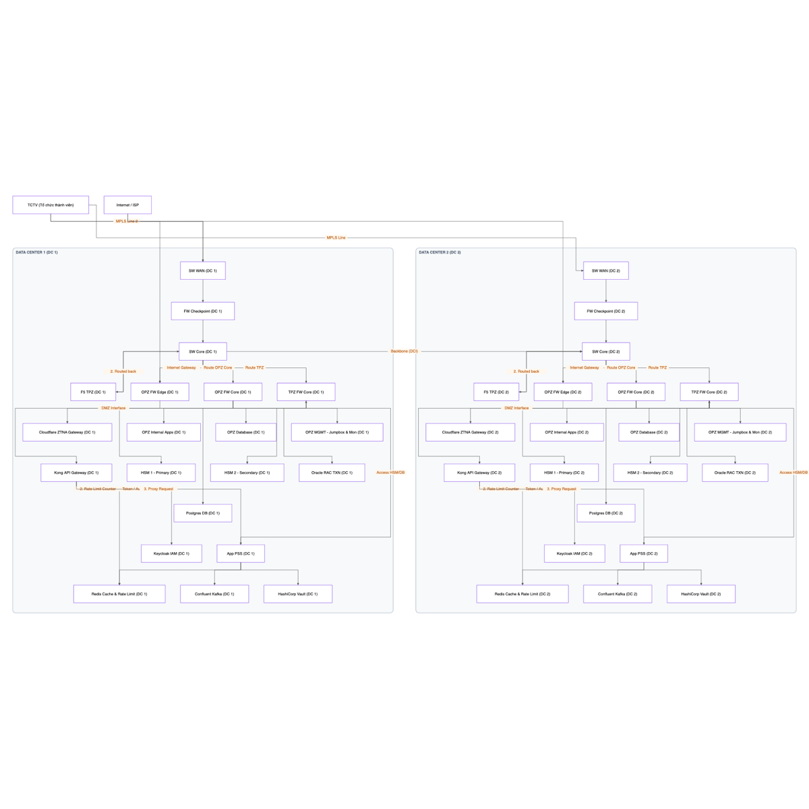
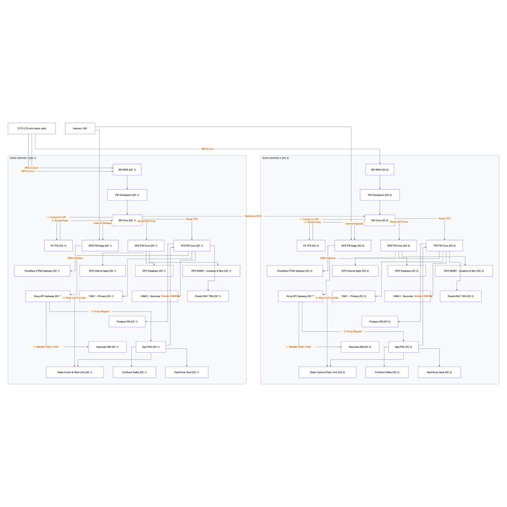
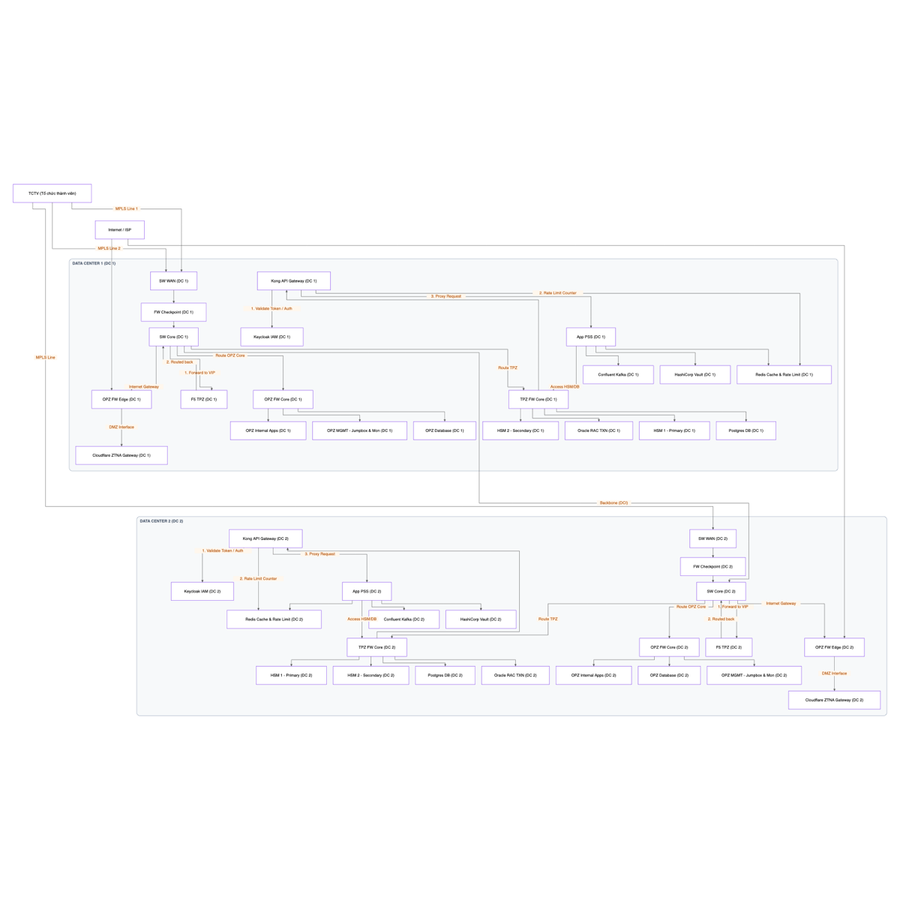
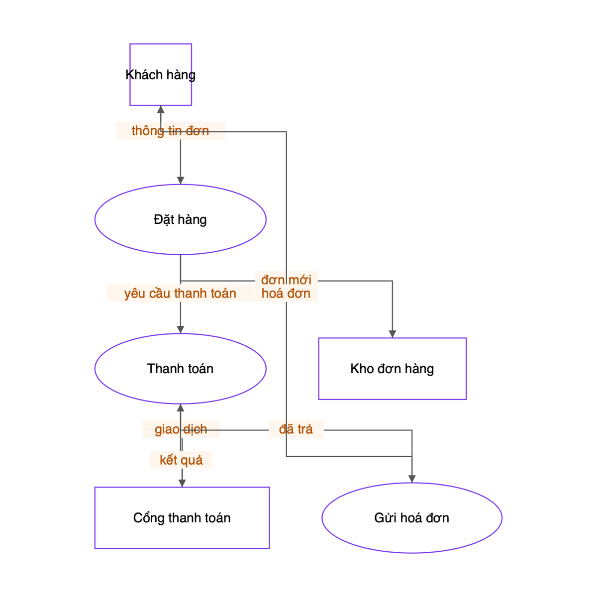
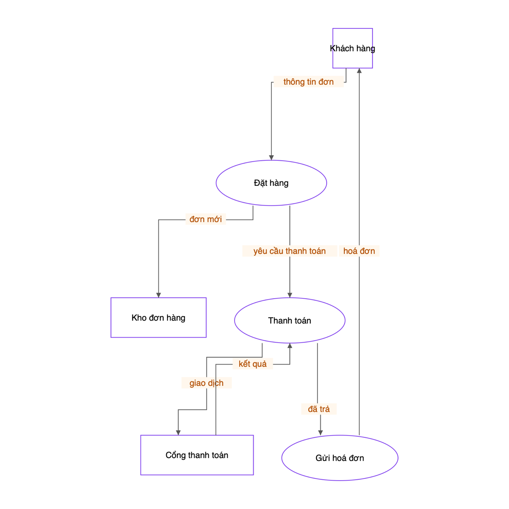
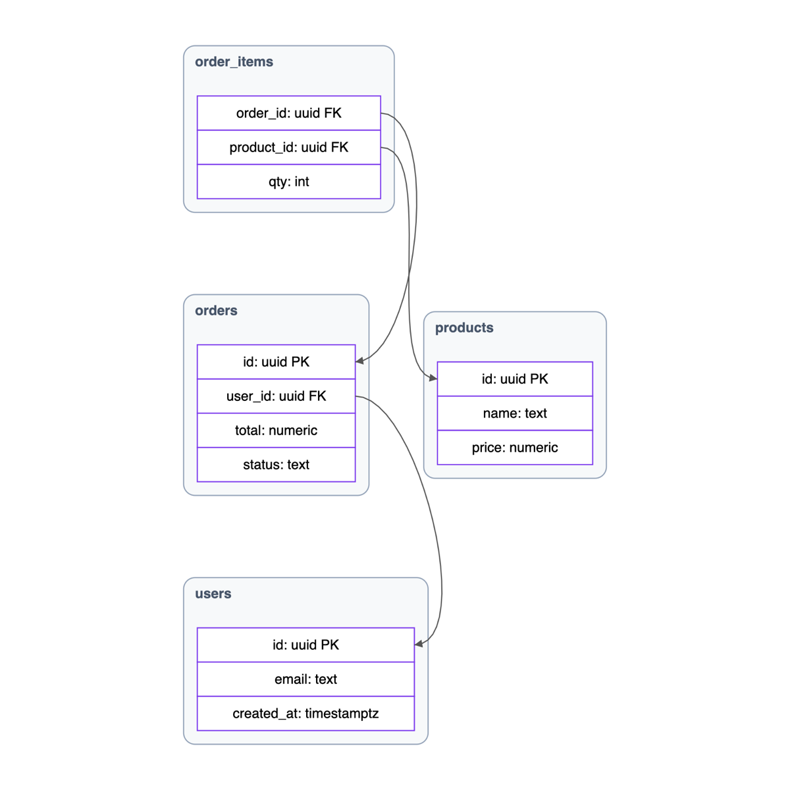
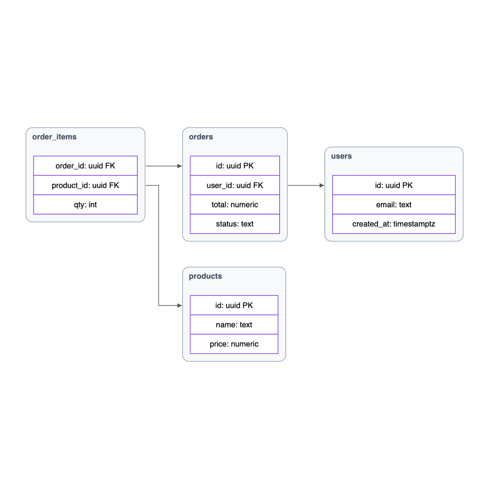
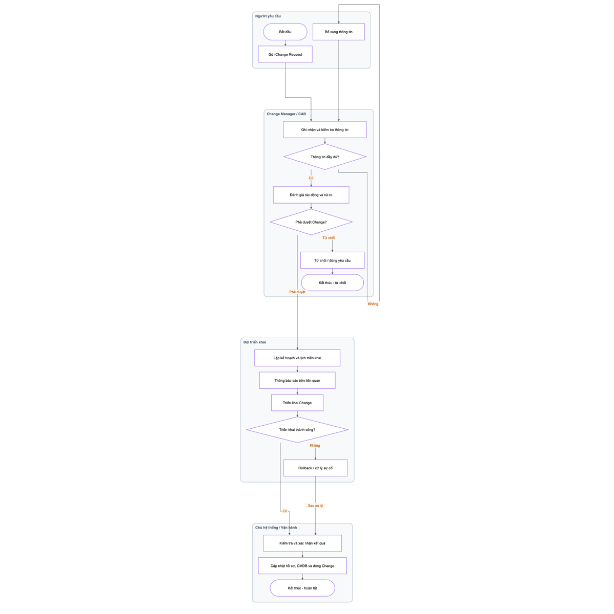

# ADR: ELK cho layout và đường nối của Whiteboard, 2026-11-13

**Trạng thái:** đề xuất, chưa quyết.
**Câu hỏi:** có nên dùng ELK (`elkjs`, Eclipse Layout Kernel) để xếp và route các sơ đồ Syn vẽ, thay cho
layout tự viết trong `src-tauri/src/syn/board.rs` (`layers`, `lanes`, `sequence`, `ranks`) và router
`orthogonalRoute` trong `src/mini-apps/whiteboard/routing.ts` không?

**Tóm tắt:** *Chưa*, ít nhất là chưa ở bước đầu. Thứ đang làm sơ đồ xấu nhất không nằm ở thuật toán xếp hộp: đó là
việc mọi đường đều phải ra/vào đúng **tâm** một cạnh. Không layout engine nào sửa được điều đó cho tới khi app
cho đường bám vào điểm bất kỳ trên cạnh. Làm việc đó trước. Sau đó **route lại đường bằng MSAGL** cho mọi board
Syn vẽ, giữ nguyên bố cục có ý nghĩa của Syn (hai site đứng cạnh nhau, lane, sequence). **ELK chỉ dùng cho
những loại ELK thật sự làm tốt hơn mà Syn không có bố cục riêng:** ERD/class (port theo từng cột) và đồ thị
không nhóm (data flow).

---

## 1. Bối cảnh

Board Syn vẽ trông kém hẳn draw.io, Miro, Archify. Lần review engine ngày 2026-11-13 (render bằng chính
`ShapeNode`, `FrameNode`, `WaypointEdge`, `EdgeMarkerDefs` của app) tìm ra hai loại nguyên nhân:

- **Layout của Syn.** Đã sửa một phần cùng ngày: bỏ cạnh quay lại trước khi xếp hạng, đường `step` tránh hộp, hình
  thoi đủ chỗ, `move_into` chỉ vào frame.
- **Giới hạn của engine**, chưa sửa:
  - mỗi shape chỉ có 4 điểm nối ở tâm 4 cạnh;
  - hai đường giữa cùng một cặp hộp trùng nhau từng pixel;
  - nhãn đặt cứng ở giữa đường, không tránh nhau;
  - router chỉ chọn giữa vài phương án L/Z;
  - shape bị ép tối thiểu 40×40 (`NodeResizer` trong `ShapeNode.vue`).

Một điều quyết định cho mọi phương án: `WaypointEdge.vue` luôn bắt đầu và kết thúc đường ở
`sourceX/Y`/`targetX/Y`, tức tâm cạnh của handle. Waypoint chỉ là các điểm ở giữa. Vì vậy dù ELK hay MSAGL có
giãn điểm nối dọc theo cạnh, app cũng sẽ kéo đầu đường về tâm cạnh, và đoạn đầu/cuối sẽ thành đường xiên.

## 2. Đã thử gì

Bản thử nằm ngoài repo, không thay đổi code chạy thật.

- **Đầu vào:** sáu board do `draw()` hiện tại sinh ra. Ba board từ sketch thật trong `src-tauri/src/syn/testdata/`
  (`board-flowchart-loop.json`, `board-swimlane.json`, `board-sketch.json` — 44 hộp DC1/DC2), cộng ba mẫu
  ERD, data flow, sequence.
- **Hiện tại:** vị trí của `board.rs`; đường tính bằng chính `routing.ts` (`sidesFacing` + `orthogonalRoute`, đóng
  gói bằng esbuild), đúng như app vẽ.
- **ELK** (`elkjs` 0.12.1): xếp lại toàn bộ bằng `layered`, `ORTHOGONAL`, `INCLUDE_CHILDREN` (frame thành
  compound node), `considerModelOrder`. ERD dùng một port mỗi cột, `FIXED_POS`, đặt ở cạnh trái và phải của dòng.
- **MSAGL route-only** (`@msagl/core` 1.1.24, `routeRectilinearEdges`): giữ nguyên vị trí hộp của Syn, chỉ route đường;
  frame không tính là vật cản, giống app.

Cách đo: đếm điểm nối dùng chung (hai đầu đường chạm một hộp ở cùng một điểm), tổng độ dài các đoạn đường của hai
đường khác nhau nằm chồng lên nhau, số cặp nhãn đè nhau, nhãn đè lên hộp, và số chỗ gấp.

## 3. Kết quả

| Board | Cách | Điểm nối chụm | Đường trùng (px) | Nhãn–nhãn | Nhãn–hộp | Đường cắt | Chỗ gấp | Khổ |
| --- | --- | ---: | ---: | ---: | ---: | ---: | ---: | --- |
| Flowchart (16 hộp) | hiện tại | 7 | 192 | 0 | 0 | 0 | 40 | 555×1816 |
| | MSAGL | 0 | 0 | 0 | 1 | 3 | 35 | 555×1816 |
| | ELK | 0 | 0 | 0 | 0 | 0 | 12 | 558×1830 |
| Swimlane (17 hộp, 4 lane) | hiện tại | 2 | 92 | 0 | 0 | 0 | 12 | 4503×640 |
| | MSAGL | 0 | 0 | 0 | 0 | 0 | 6 | 4503×640 |
| | ELK | 0 | 0 | 0 | 0 | 0 | 14 | 452×2006 — **không còn là swimlane** |
| DC1/DC2 (44 hộp, 52 đường) | hiện tại | 40 | 13 258 | 5 | 0 | 11 | 120 | 2482×1320 |
| | MSAGL | 0 | 0 | 4 | 4 | 42 | 83 | 2482×1320 |
| | ELK | 0 | 0 | 0 | 0 | 2 | 88 | 2685×1633 — **hai DC chồng dọc** |
| Data flow (6 hộp) | hiện tại | 6 | 186 | 3 | 0 | 2 | 14 | 371×464 |
| | MSAGL | 0 | 0 | 1 | 0 | 1 | 11 | 371×464 |
| | ELK | 0 | 0 | 0 | 0 | 0 | 12 | 405×638 |
| ERD (4 bảng) | hiện tại | 0 | 0 | 0 | 0 | 1 | — | 370×612 |
| | ELK + port | 0 | 0 | 0 | 0 | 0 | 2 | 677×362 |

Thời gian: ELK 33–68 ms, MSAGL 16–49 ms mỗi board, chạy trong Node trên máy này.

Bảng này **không đo đường đi xuyên qua hộp**. Khi làm Bước 1 mới thấy MSAGL có làm thế; xem mục 9.

Ảnh (cùng cách vẽ cho mọi cột, không phải ảnh chụp app):

| | Hiện tại | MSAGL | ELK |
| --- | --- | --- | --- |
| DC1/DC2 |  |  |  |
| Data flow |  | |  |
| ERD |  | |  |
| Swimlane | | |  |

## 4. Đọc kết quả

**Thứ xấu nhất hiện nay là đường chụm và đường trùng, không phải đường cắt.** Board DC đang có 40 đầu đường dùng
chung điểm và khoảng 13 nghìn pixel đường đè lên nhau. Cả ELK lẫn MSAGL đều đưa hai số này về 0. Lý do chung: cả hai
đều giãn điểm nối dọc cạnh và giữ khoảng cách giữa các đường song song. Đó là thứ engine của mình không có.

**ELK làm tốt khi được tự đặt hộp:**
- ít đường cắt nhất (DC: 2, so với 11 hiện tại);
- ít chỗ gấp;
- nhãn không đè nhau;
- ERD có đường nối đúng vào từng dòng cột nhờ port.

**ELK không giữ được bố cục mang nghĩa:**
- **Hai DC bị chồng dọc** thay vì đứng cạnh nhau, và không còn đối xứng. Bố cục cạnh nhau chính là lý do `layers()`
  được viết ra (người dùng đã chê bản Mermaid vì lý do này).
- **Swimlane:** ELK không có khái niệm lane. Lane thành các compound node rồi bị xếp theo tầng, ra một cột dài 2.000 px.
- **Sequence:** không có lifeline, cũng không có message ở độ cao bất kỳ.

**MSAGL route-only giữ nguyên ý của Syn**: hai site đứng cạnh nhau, lane là hàng ngang. Nó cũng xoá hết điểm chụm và
đường trùng. Đổi lại, khi vị trí hộp đã cố định thì có những chỗ cắt mà router không tránh được: DC tăng từ 11 lên 42
đường cắt, và vài nhãn đè lên hộp. Swimlane đẹp hơn rõ: 0 chỗ chụm và chỉ 6 chỗ gấp, so với 12.

## 5. Ràng buộc kỹ thuật

| | `elkjs` 0.12.1 | `@msagl/core` 1.1.24 |
| --- | --- | --- |
| Giấy phép | EPL-2.0 hoặc GPL-3.0 | MIT |
| Kích thước | 1,6 MB min, ~475 KB gzip (tải cả gói) | phần route-only sau tree-shake: 588 KB min, ~144 KB gzip |
| Chạy ở đâu | Web Worker có sẵn (`elk-worker.min.js`) | đồng bộ trên main thread; dưới 50 ms cho 52 đường |
| Safari 17.4 (`CLAUDE.md`) | ES5 do GWT biên dịch, có dùng `BigInt` (Safari 14+), esbuild build với target `safari17.4` không lỗi | TS biên dịch, esbuild build với target `safari17.4` không lỗi |
| Đã kiểm trên WKWebView thật | **chưa** | **chưa** |

Cả hai đều không cần polyfill tự viết. Với EPL, việc dùng thư viện nguyên bản không phát sinh nghĩa vụ gì cho
một app cá nhân; nghĩa vụ chỉ áp lên file EPL nếu ta sửa chúng.

**Phía Rust:** chưa có crate nào trưởng thành gom đủ layered layout, port, compound và routing vuông góc. Các ứng
viên tìm thấy đều mới ở bản 0.1–2.0, nhắm vào đầu ra cho terminal/Mermaid, hoặc chỉ có một nửa bài toán: `mmdflux`,
`bra0-layout`, `dagre-dgl-rs`, `msagl-rust` 0.1, `libavoid-rust`. Board lưu vị trí và waypoint trong chính file,
nên chạy layout ở webview **một lần** rồi ghi lại là đủ; Rust không cần tự làm.

## 6. Đề xuất

**Bước 0 — điều kiện cho mọi phương án (engine, front-end):**
1. **Đầu đường ở điểm bất kỳ trên cạnh.** Thêm vào `edge.data` một vị trí dọc cạnh cho mỗi đầu, ví dụ
   `sourceAt: { side, t }` với `t` từ 0 đến 1. `WaypointEdge` dùng nó thay cho tâm handle. Thiếu bước này thì cả ELK
   lẫn MSAGL đều bị kéo về tâm cạnh khi hiện trong app.
2. Vẽ đường waypoint vuông góc, có bo góc; lưu vị trí nhãn do layout tính (`data.labelAt`).
3. Hai lỗi nhỏ tìm thấy cùng ngày:
   - `BoardPane.vue` không có `EdgeMarkerDefs` và không đăng ký `#edge-step`/`#edge-straight`, nên đường trong pane
     chat mất mũi tên.
   - `ShapeNode` ép tối thiểu 40×40, làm phình thanh activation của sequence.

**Bước 1 — MSAGL route-only cho mọi board Syn vẽ.** (Đã làm, khác vài chỗ; xem mục 9.) `draw_board` giữ bố cục của Rust và đánh dấu board
`metadata.routing = "pending"`. Khi app mở board đó lần đầu, nó route bằng MSAGL, ghi `waypoints`, `sourceAt`/`targetAt`
và `labelAt` vào file, rồi xoá cờ. Từ đó board là của người dùng như mọi board khác. Thêm lệnh "Sắp lại đường" cho board
người dùng tự vẽ: cùng một hàm, áp dụng cho các đường đang chọn.

**Bước 2 — ELK cho các loại mà Syn không có bố cục riêng có nghĩa:** (Đã làm, khác vài chỗ; xem mục 10.)
- Sketch có `fields`: ERD/class, port theo từng cột.
- Sketch không có `group`, `lane` hay `order`: data flow, đồ thị tự do.

Cờ là `metadata.layout = "pending"`. Lane, sequence và site đứng cạnh nhau vẫn để Rust xếp.

**Không làm:** thay toàn bộ layout của Syn bằng ELK. Bố cục theo nghĩa (site cạnh nhau, lane, thứ tự thời gian) là thứ
người dùng đã yêu cầu rõ, và ELK không có cách giữ nó mà không phải cấu hình riêng cho từng loại.

## 7. Rủi ro và câu hỏi mở

- **Chưa chạy hai thư viện trong WKWebView thật.** Phải chạy thử trên macOS 14.4 trước khi gộp vào.
- **Route khi mở board:** nếu người dùng mở board trên Android trước, WebView cũ phải chạy được MSAGL. Cần thử,
  hoặc để Android bỏ qua và giữ đường `step` như hiện nay.
- **Số đường cắt tăng với MSAGL trên board dày.** Có thể cần thêm một bước sắp thứ tự hộp trong hàng (crossing
  minimisation) ở `layers()`. Đây là việc trong Rust, không cần thư viện.
- **Hai thư viện cộng lại khoảng 620 KB gzip,** nhưng chỉ tải khi mở một board cần route hoặc layout (dynamic import).
- **Đề xuất này chưa đo cảm nhận thẩm mỹ,** chỉ đo các lỗi đếm được. Sau Bước 0 và Bước 1 nên xem lại bằng mắt
  trong app thật.

## 8. Nguồn

- `elkjs`: <https://github.com/kieler/elkjs>, bản 0.12.1 trên npm.
- MSAGL cho JS: <https://github.com/microsoft/msagljs>, gói `@msagl/core` 1.1.24.
- Các ứng viên phía Rust (chưa thử):
  - [msagl-rust](https://gh.r-mj.com/SignalCanvas/msagl-rust) (bản mirror; không mở được lúc tìm)
  - [libavoid-rust](https://github.com/boxabirds/libavoid-rust)
  - [mmdflux](https://docs.rs/crate/mmdflux/2.0.0)
  - [bra0-layout](https://docs.rs/crate/bra0-layout/0.2.1)
  - [dagre-dgl-rs](https://docs.rs/crate/dagre-dgl-rs/latest)
- Nền lý thuyết về port trong layered layout: [Drawing Layered Graphs with Port Constraints](https://rtsys.informatik.uni-kiel.de/~biblio/downloads/papers/jvlc13.pdf).

## 9. Bước 1 đã làm, 2026-11-14

Code nằm trong `src/mini-apps/whiteboard/autoRoute.ts`. Phía Rust là `route_later` / `reroute_lines_of` trong
`board.rs`. Những chỗ khác so với mục 6:

- **Cờ đặt trên từng đường, không đặt trên board:** `data.routing = "pending"`. Lý do:
  - `edit_board` thêm một đường thì chỉ đường đó cần route.
  - Sync gộp hai bản board theo từng đường.

  Sequence và đường nối vào field không có cờ.
- **`edit_board` dời một hộp** (`place`, `move_into`): các đường bậc thang nối vào hộp đó bị gỡ góc cũ và được đánh
  dấu route lại.
- **Đường do router vẽ có dấu `data.routed`:**
  - Khi kéo hộp ở một đầu, đường bám theo hộp như đường bậc thang cũ.
  - Thả ra thì đường được route lại, chung một bước undo với cú kéo.
  - Căn hộp (align) và phím mũi tên cũng làm vậy.
  - Người dùng tự bẻ góc thì dấu này bị gỡ, góc đứng yên như mọi waypoint khác.

  Nếu không có dấu này, kéo một hộp sẽ để lại đường xuyên qua chính hộp đó, tệ hơn trước Bước 1.
- **Pane cạnh chat cũng route** board Syn vừa vẽ, và ghi kết quả vào file, vì người dùng thường thấy board ở đó trước.
- **Lệnh "Sắp lại đường"** nằm ở menu khi chọn nhiều thứ và ở menu của một đường.
- **Hàng không thuộc nhóm nào được canh giữa** (`layers()`), giống hàng trong nhóm. Trước đó hàng dồn trái, hai hộp
  khác bề rộng trên dưới nhau thì tâm lệch, nên đường nào cũng phải bẻ một khúc.

**MSAGL có lúc cho đường đi xuyên hộp.** Trên flowchart Change Request:
- "Có" từ "Triển khai thành công?" đi thẳng xuống xuyên qua hộp "Rollback".
- "Từ chối → Kết thúc" xuyên qua ba bước.

Lỗi có sẵn trong đường ngắn nhất, trước cả bước nudge. Không tuỳ chọn nào của router sửa được
(`RouteToCenterOfObstacles`, `LimitPortVisibilitySpliceToEndpointBoundingBox`, padding, separation, xê dịch toạ độ).
Với ba hộp đứng riêng thì không tái hiện được; thêm gần như bất kỳ hộp nào khác của board là lỗi xuất hiện. Vì vậy:

- Mọi đường MSAGL trả về đều được kiểm (`runsThrough`). Đường nào xuyên hộp thì dùng router tự viết của app
  (`orthogonalRoute`) giữa hai đầu MSAGL đã chọn. Nếu vẫn xuyên thì bỏ, đường giữ dạng bậc thang tự tìm lối.
- Kết quả: flowchart 18/18 đường được route, swimlane 18/18, data flow 7/7, DC 48/52. Không đường nào xuyên hộp.
  Test dùng chính board Rust vẽ (`__tests__/fixtures/change-request-drawn.json`).

**Shape không phải hình chữ nhật:**
- Router chỉ biết khung bao. Một đường kết thúc ở một phần ba đáy khung bao hình thoi sẽ dừng cách hình thoi một khoảng.
- Giờ app đọc `path` của shape: đường chỉ được chạm cạnh ở đoạn thẳng thật của nó, cạnh không có đoạn thẳng thì chạm ở
  giữa (đỉnh hình thoi).
- MSAGL được đưa bao lồi của shape, nên đường ra thẳng từ đỉnh và tìm lối từ đó.
- Shape có đường viền không phủ kín khung (đám mây) hoặc vẽ bằng lệnh cung (người que) thì vẫn coi là hộp chữ nhật.
  Với outline của đám mây, MSAGL ném lỗi; khi đó app chạy lại router với toàn khung chữ nhật.

**Vẫn chưa làm hoặc chưa kiểm:**
- Chưa chạy trong WKWebView thật (macOS 14.4) và trên Android. Code trong chunk MSAGL không gọi API nào mà Safari 17.4
  thiếu (đã dò trong bản build), nhưng chưa chạy thử.
- Hai đường cùng vào một đỉnh hình thoi vẫn chung điểm, ví dụ "Không" và đường quay lại từ "Bổ sung thông tin".
- Board nhúng trong note, ảnh xem trước trong chat và export draw.io/Excalidraw chưa đọc `sourceAt`/`targetAt`/`labelAt`.

## 10. Bước 2 đã làm, 2026-11-14

Code nằm trong `src/mini-apps/whiteboard/autoLayout.ts`. Phía Rust là `left_to_elk` / `lay_out_later` trong
`board.rs`. Những chỗ khác so với mục 6:

- **Loại nào dùng ELK:** sketch xếp theo `layers` mà không item nào có `group`, `row` hay `col`. Gồm flowchart, data
  flow, bảng và các đường nối giữa chúng. Không dùng ELK khi:
  - có `lane` hoặc `order`;
  - bảng nằm trong nhóm (site): ELK sẽ chồng các site lên nhau;
  - Syn đã nói rõ hàng/cột của item.
- **Cờ đặt trên từng item:** `data.layout = "pending"`, chứ không phải `metadata.layout`. Cùng lý do với cờ route:
  sync gộp theo từng item, nên bản đã xếp mới hơn ở mọi item nó dời.
  - App xếp lại cả board khi còn item nào mang cờ, rồi gỡ cờ khỏi mọi item.
  - Nếu một edit đã thêm frame vùng hoặc một thứ không phải hộp/bảng, app chỉ gỡ cờ, không dời gì.
  - `edit_board place` gỡ cờ ngay, vì xếp lại sẽ đặt hộp đi chỗ khác.
- **ELK chạy ở đâu, theo thứ tự nào:** chạy trước router, trong cả Whiteboard lẫn pane cạnh chat.
  - Đường ELK vẽ được ghi giống hệt đường MSAGL vẽ (`routed`), nên cũng bám theo hộp khi kéo.
  - Đường nào của ELK đi xuyên hộp thì để lại cho MSAGL.
  - ELK không chạy được (ví dụ WebView cũ) thì board giữ bố cục Rust, đường vẫn được route, và lần mở sau thử lại.
- **Hình thoi có điểm nối cố định ở bốn đỉnh.** Để ELK tự chọn thì nó giãn đầu đường dọc cạnh. Khi dời về đỉnh, ba
  đường của một câu hỏi dồn vào một đỉnh và chạy đè nhau. Giờ:
  - Đường vào đi vào đỉnh trên.
  - Chỉ một câu trả lời ra đỉnh dưới. Các câu trả lời khác ra hai bên, cái xa hơn chọn trước.
  - Đường quay lại vào đỉnh bên phía nó, trừ khi bên đó đã có câu trả lời đi ra; khi đó nó vào đỉnh trên.
- **Thứ tự của Syn được giữ** (`considerModelOrder` và `cycleBreaking: MODEL_ORDER`, theo vị trí Rust đã xếp):
  bước mà câu hỏi gửi quay lại vẫn nằm trên câu hỏi.
- **Bảng:** cả bảng là một node, mỗi dòng có một cổng ở mỗi bên (`FIXED_POS`). Board đi từ trái sang phải; đường ra
  ở cạnh phải dòng nguồn và vào ở cạnh trái dòng đích.
- **Nhãn:** ELK đặt nhãn bên cạnh đường, còn app vẽ nhãn nằm trên đường. Trên data flow, hai đường hai chiều giữa
  cùng một cặp hộp có nhãn đè nhau.
  - Cho ELK đặt nhãn trên đường (`inline`) thì nó bẻ thêm bốn khúc để đi qua nhãn, nên không dùng.
  - Thay vào đó, `placeLabels` trượt nhãn dọc theo đường của nó tới chỗ không đè nhãn khác và không đè hộp.
  - Router MSAGL cũng dùng hàm này, nên board ở Bước 1 và lệnh "Sắp lại đường" cũng được.
- **Sửa một lỗi của Bước 1:** `saveBoard` của pane chỉ ghi vị trí hộp, nên đường pane route chưa bao giờ vào file.
  Giờ `writeItemChanges` ghi cả đường (`type`, route) và gỡ được khoá (`layout`, `routing`), vẫn chỉ ở chỗ pane sửa
  sau cùng.

**Kết quả trên board Rust vẽ** (test dùng chính các board này, `__tests__/fixtures/elk-*.json`):

| Board | Đường do ELK route | Xuyên hộp | Chỗ gấp | Khổ | ELK |
| --- | ---: | ---: | ---: | --- | ---: |
| Flowchart Change Request (16 hộp) | 18/18 | 0 | 15 | 632×1854 | ~95 ms |
| ERD (4 bảng) | 3/3 | 0 | 4 | 753×362 | ~8 ms |
| Data flow (6 hộp, 2 cặp hai chiều) | 7/7 | 0 | 14 | 395×638 | ~8 ms |

Thời gian đo trong Node; chunk `elk.bundled` riêng là 449 KB gzip, chỉ tải khi có board cần xếp. Trong bản build,
chunk này không gọi `Promise.try`, `URL.parse`, `toHex`, `transferToFixedLength`, `withResolvers`, `groupBy`,
`findLast`, `.at(`. Không có `eval` hay `new Function`, nên CSP `script-src 'self'` vẫn chạy được.

**Vẫn chưa làm hoặc chưa kiểm:**
- Chưa chạy trong WKWebView thật (macOS 14.4) và trên Android, giống Bước 1.
- ELK chạy trên main thread: 1,5 MB JS phải parse một lần, chưa đo trên máy yếu. Nếu thấy giật thì chuyển sang
  `elk-api` với `elk-worker.min.js`.
- Đã xem bằng mắt flowchart, ERD và data flow trong `WhiteboardApp` chạy trên trình duyệt. Chưa xem board lớn hơn
  khoảng 20 hộp mà không có nhóm.

